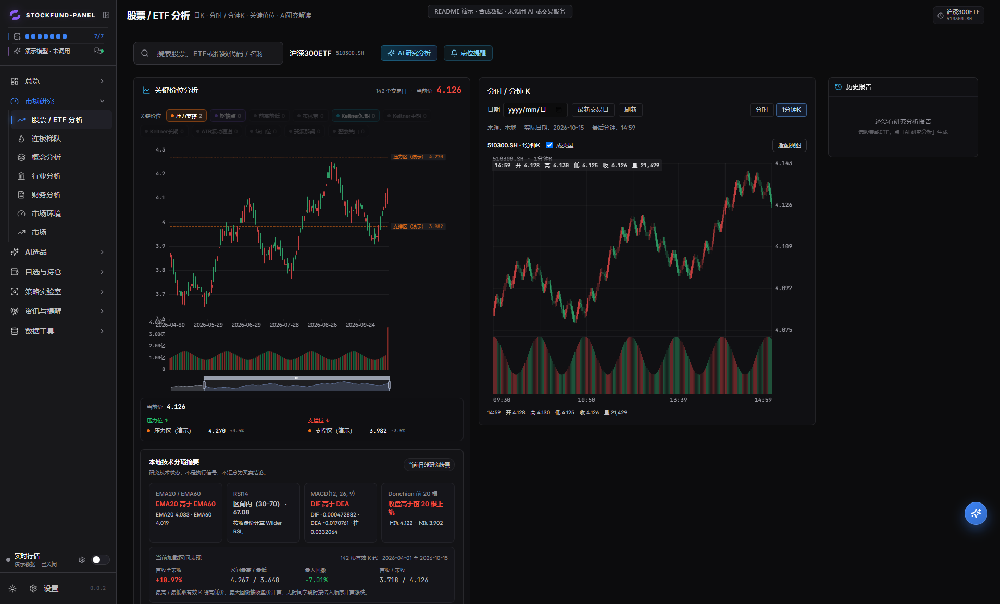
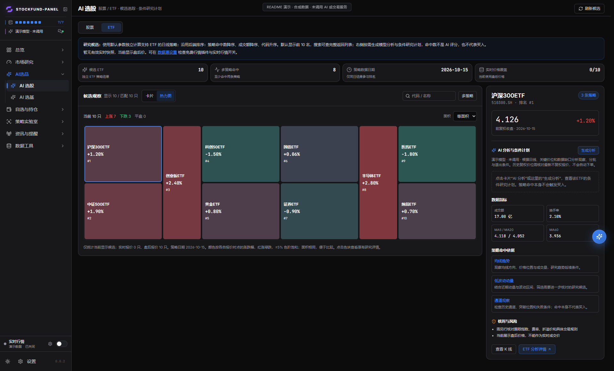
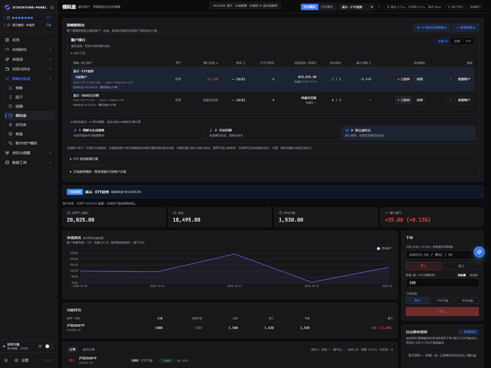
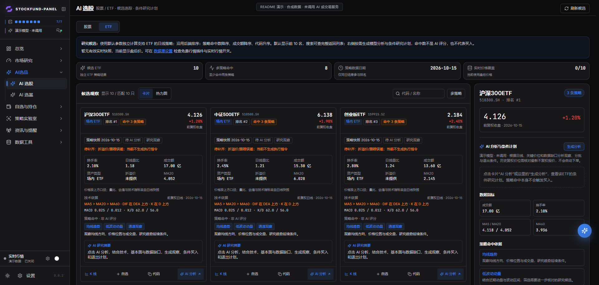

<p align="center">
  
</p>

<h1 align="center">stockfund-panel</h1>

<p align="center"><strong>本地优先的股票、ETF 与基金研究看板</strong></p>
<p align="center">行情与图表 · 策略筛选 · AI 研究 · 历史回测 · 独立模拟账户</p>
<p align="center">
  <a href="#界面预览">界面预览</a> ·
  <a href="#快速开始">快速开始</a> ·
  <a href="#上手路线">上手路线</a> ·
  <a href="#文档导航">文档导航</a> ·
  <a href="LICENSE">MIT License</a>
</p>

由 **HamizDev 独立维护**，把行情观察、候选筛选、策略验证和模拟跟踪放在同一个界面里。支持股票、场内 ETF、场外基金研究，以及独立的数字资产模拟模块；数据源和 AI 服务按需配置，个人数据与密钥保存在使用者自己的运行环境。

当前版本 **0.0.10**：[版本说明](docs/release-0.0.10.md) · [研究工具](docs/research-tools.md) · [港美股数据范围与口径](docs/global-markets.md) · [更新历史](CHANGELOG.md) · [本地 Jevos 辅助判断](docs/local-jevos.md)。

## 功能亮点

- **从行情看到研究依据**：日 K、分时、1 分钟 K、关键价位与技术分项摘要；明确显示数据时间、来源和缺失项。
- **三市场观察与广度**：A/HK/US 首页、港美股市场分布与行业热度；样本范围和数据延迟见 [数据口径](docs/global-markets.md)。
- **股票与 ETF 分开筛选**：默认 Top 10 候选，支持名称搜索、卡片 / 热力图切换和逐标的研究详情。
- **AI 按需辅助**：解释候选、比较基金、生成与迭代策略草稿、解读持仓和快讯；研究报告展示客观证据与风险，不输出加减仓等操作结论。复用使用者自己的模型配置。
- **从回测走到模拟验证**：策略独立账户、净值曲线、费用、订单、成交台账、已平仓回合与账户对照。
- **本地管理，按能力接源**：日线、分钟、实时、五档、财务等能力分别配置；插件不满足条件时明确显示不可用。
- **保持研究过程连贯**：分组菜单、名称优先、浏览状态保存、候选缓存和快讯当日缓存，减少反复查找。
- **研究资料与数字可追溯**：模拟持仓风险体检、免费产业及港股资料、财报/派息日历、本地文档检索和报告逐项数字核对；按需取数与解读，详见[研究工具](docs/research-tools.md)。

## 界面预览

以下为当前公开版本的真实前端界面，**截图统一使用隔离的合成演示数据**，并带有演示标记。证券名称仅用于展示；价格、日期、资金、净值和策略命中均不是实际市场记录、历史回测成绩或收益承诺。截图未使用个人账户、持仓、密钥或真实交易记录。点击图片可查看大图。

### 股票 / ETF 图表与技术研究

日 K 与分钟面板并排查看，结合压力支撑、成交量和本地技术分项摘要；可切换分时 / 1 分钟 K，并联动选择交易日期。



### 候选热力图

红涨绿跌，支持等面积或按有效成交额布局。统计只覆盖当前显示候选；点击色块打开同一标的的研究详情。



### 独立模拟账户

在同一页面核对账户排行、启用状态、资产、净值、持仓和订单。没有已平仓回合时，胜率保持为空。



<details>
<summary><strong>展开查看：Top 10 候选卡片</strong></summary>

卡片集中显示策略命中、价格、技术状态、缺失字段和研究入口；命中数不是 AI 评分。



</details>

## 功能一览

| 模块 | 当前能力 |
| --- | --- |
| 股票看板 | 市场概览、自选、K 线、指数、资金与数据同步状态 |
| 图表与指标 | 行情浏览日 K 和数字资产 K 线使用本地 Canvas；专项分析、分时及净值继续使用 ECharts。提供缩放、拖动、十字线及适用场景下的均线、通道和成交标记 |
| 策略研究 | 条件选股、历史回测、策略命中追踪与个股分析 |
| 基金中心 | 基金搜索、自选与持仓、净值和历史业绩筛选；部分数据取决于已配置的数据源 |
| AI 选股 | 股票与 ETF 分区默认显示 Top 10，按策略命中数、成交额排序；支持卡片 / 热力图、涨跌分布、独立展示状态与名称搜索，配置模型后进行逐标的分析 |
| AI 选基 | 默认显示 10 个历史榜单候选；全部类型按股票、混合、指数、债券四类轮流取样，分开标注类别候选序号；可搜索更多，再由已配置模型辅助比较并显示数据缺口 |
| 持仓日报 | 股票/ETF 持仓提醒与基金持仓分别分析；北京时间当天首次打开自动生成，同日复用，失败仅手动重试；输出带数据日期的客观状态、证据和风险核对，不下单 |
| 市场快讯 | 财联社 + 东财7×24 免费公开快讯；分类筛选、股票/ETF 直接关联、逐条 AI 解读与当日样本研判，详见[使用说明](docs/market-news.md) |
| 股票 / ETF 模拟 | 手动账户、策略独立账户、ETF 日线及短线研究方案、账户排行、净值与历史重放；自动规则生成**模拟**订单，不连接券商账户 |
| 数字资产本地模拟 | Bitget USDT 本位 BTC/ETH/SOL 公开行情驱动的纸面策略；支持 1h/4h、1–20 倍杠杆及策略 AI 草案；旧币安账本只读 |
| 交易所官方模拟 | OKX / Bitget 模拟专用账户连接，Bitget Classic / UTA 模式；OKX 另有三套按标的隔离归因的预设策略，需专用凭据、预检和显式启用，见[版本说明](docs/release-0.0.2.md) |
| 本地 Jevos 辅助 | 快讯线索初筛、关注与登记持仓名称关联，以及 OKX 原策略信号的只读对照；本地模型另行运行，意见不参与下单，见[使用说明](docs/local-jevos.md) |
| 监控与研究工具 | 价格提醒、策略信号、连板梯队、异动监控、快讯解读和可选的单标的竞价研究；可用范围取决于数据源 |
| 研究资料与风险体检 | 只读模拟组合风险、GPU/存储/供应链指标、港股南向与派息、财报事件、本地资料检索及报告数字核对；数据按需查询、失败保留旧快照 |
| 数据源 | TickFlow、扶摇及可选的插件或自定义数据源；各来源的权限和覆盖范围不同 |

选股和选基结果用于研究。页面会标出行情时间、来源和已知缺失字段；不要把历史收益、策略命中或模型文字当成交易结论。

## 快速开始

<p align="center"><strong>已安装 Docker？从源码构建并启动 ⬇️</strong></p>

```bash
git clone https://github.com/HamizDev/stockfund-panel.git
cd stockfund-panel
cp .env.example .env
docker compose up --build -d
```

**打开 <http://127.0.0.1:3018> 即可访问。** 上面是 macOS/Linux 命令；Windows PowerShell 请看方式 A。宿主机需要 Git 和 Docker Compose，无须另装 Python 或 Node.js。当前没有本项目的 GHCR 现成镜像，Compose 会在本机从源码构建；不要使用其他项目的镜像。

| 方式 | 适合谁 | 前置要求 |
| --- | --- | --- |
| **A · Compose 本地构建** ⭐ 推荐 | 想运行看板，不打算改源码 | Git、Docker Desktop 或 Docker Engine + Compose 插件 |
| **B · 本机 AI 代部署** | 希望 AI 编程助手检查环境、执行部署步骤 | 能操作本机文件和终端的 AI 编程助手；由其确认所需依赖 |
| **C · Dev 模式** | 修改前后端、调试和二次开发 | Git、Python ≥ 3.11、Node.js ≥ 20、pnpm 9、uv |

### 方式 A：Docker Compose 本地构建

在 Windows PowerShell 中逐条执行：

```powershell
git clone https://github.com/HamizDev/stockfund-panel.git
Set-Location stockfund-panel
Copy-Item .env.example .env
docker compose up --build -d
```

macOS/Linux 使用上方的快速启动命令。若宿主机端口 `3018` 已被占用，**先**在新仓库的 `.env` 中修改 `PORT`，再运行最后一条命令；不要停止已有服务。默认 `BIND_HOST=127.0.0.1`，只允许本机访问。运行数据保存在新仓库的 `data/`，不会写入 Git；密钥由使用者在设置页或自己的 `.env` 中填写。

镜像默认不安装可选的 `stock-sdk` 插件，也不挂载宿主机 Codex 登录文件。要在看板中使用本机 Codex CLI，建议采用方式 C，并在运行看板的同一用户环境中登录；外部 AI API 可在设置页单独配置。

### 方式 B：本机 AI 代部署

把下面整段提示词交给**能够操作你本机文件和终端**的 AI 编程助手。它会先检查环境和已有服务，再向你确认具体操作；无需把 API Key、密码或 Codex 登录文件粘贴进对话。

```text
请在我的电脑上部署 https://github.com/HamizDev/stockfund-panel ，优先使用仓库自带的 Docker Compose 本地构建。

先只读检查操作系统、Git、Docker、目标目录和端口 3018，并在线阅读仓库的 README.md、docs/deployment.md、docker-compose.yml 与 .env.example。列出准备执行的命令、目标目录、端口和对现有服务的影响，得到我确认后再克隆仓库、安装依赖、创建配置或启动服务。

如果目标目录已有 .env 或 data/，保留它们并先给出备份方案；如果 3018 被占用，给新部署选其他端口，不要停止或覆盖已有看板。不要重装或重置 Docker/WSL，不要清理容器、镜像或数据，也不要修改其他项目。

密钥和登录信息由我在本机设置页填写；不要索取、打印、上传或提交 API Key、密码、私钥、Codex 登录文件或个人数据。完成后检查 docker compose ps、/health 和首页 HTTP 响应，告诉我实际访问地址、数据目录、已启用功能及仍需我配置的项目。若 Docker 不可用，先说明原因和可选的本地开发方案，不要自行修复系统环境。
```

AI 助手需要本机文件和终端权限才能代为执行；只有聊天能力的助手可以指导你，但无法直接完成安装。首次启用数据源和 AI 服务仍需要你自己的账号或 Key。

### 方式 C：Dev 模式

需要 Python 3.11+、Node.js 20+、pnpm 9 和 uv。先克隆仓库并从 `.env.example` 建立自己的 `.env`；然后在 Windows 运行 `./dev.ps1`，在 macOS/Linux 运行 `./dev.sh`。例如，Windows 上已有服务占用默认端口时：

```powershell
Copy-Item .env.example .env
./dev.ps1 -BackendPort 3020 -FrontendPort 3021
```

开发脚本遇到端口占用会安全退出，不会结束已有服务。前后端分别监听脚本输出的端口。单独验证构建时，在 `frontend/` 执行 `pnpm install --frozen-lockfile` 与 `pnpm build`；在 `backend/` 执行 `uv sync --frozen --extra dev` 与 `uv run --frozen pytest -q tests`。

## 数据源与密钥

没有任何个人账号、API Key、持仓或历史行情随源码提供。首次启动后，进入 **设置 → 数据源**，按需要配置：

| 来源 | 获取方式 | 说明 |
| --- | --- | --- |
| [TickFlow](https://tickflow.org/) | 在其官网注册并获取 API Key | 股票数据能力随账号档位变化；部分历史日线能力可在未填 Key 时使用 |
| [扶摇](https://fuyao.aicubes.cn/docs/quickstart/) | 登录扶摇后，在 API Key 管理页创建 Key | 基金及部分增强行情接口需要 Key；未配置时相关请求可能显示 503 |
| AkShare | 见 [AkShare 项目](https://github.com/akfamily/akshare) | `bin/akshare-proxy.py` 是可选的本地基金数据辅助服务，需自行安装 `akshare`；目前仅支持与后端在同一主机运行。默认 Docker Compose 无法连接宿主机代理；基金榜单和单位净值有东方财富直接回退，其他资料仍取决于可用来源 |
| 东方财富 / 天天基金公开档案 | [免费基金研究数据](docs/fund-public-data.md) | 无需 Key：费率条件、披露股票持仓、相关报告公告、区间观测回撤和单位净值；不保证实时、完整或持续可用 |
| 财联社电报 / 东方财富7×24 | [市场快讯](docs/market-news.md) | 无需 Key：最新公开快讯，分别显示来源状态、原文与发布时间；有界缓存，不保证历史完整性 |
| `stock-sdk` 插件 | 见 `backend/app/plugins/stocksdk/` | 可选插件，不随 Docker 默认构建安装；使用前核对数据来源条款 |
| zzshare 分钟插件 | [单标的分钟说明](docs/free-minute-data.md#已接入-zzshare-单标的分钟) | 股票分钟按需查询，有匿名节流与价格口径检查；不声明全市场分钟，也不用于 ETF 或指数 |
| ELTDX 独立研究网关 | [安装与覆盖说明](docs/eltdx-gateway.md) | 可选的单标的研究分钟与当日股票批量分钟通道；需单独安装并遵守上游研究许可，未随镜像分发 |
| 市场资金流、概念与行业 | [shy313.com](https://shy313.com/) 的公开接口 | 对应页面和预设数据会请求 `shy313.com/api/plugins/market_flow/exports`；接口失败时相关内容可能为空 |
| 数字资产公开行情 | [本地图表与官方模拟说明](docs/local-chart-and-official-demo.md) | OKX / Bitget 公开行情图表不需要账户密钥；本地 Bitget 纸面策略与交易所官方模拟分开，后者必须使用模拟专用凭据 |

密钥可以在看板设置页填写，也可按 `.env.example` 的字段配置 `.env`。实际密钥文件、`data/` 和本地日志均不应提交。免费或公开网页数据可能延迟、限流或变更接口；软件不会保证实时性或完整性。

## 上手路线

| 想做什么 | 建议顺序 |
| --- | --- |
| 看股票或 ETF | 设置数据源 → 同步所需日线 → 股票 / ETF 分析 → 搜索名称 → 查看日 K、分钟与数据日期 |
| 找研究候选 | AI 选股 → 股票 / ETF 分区 → 看 Top 10 卡片或热力图 → 核对策略依据与缺失项 → 按需生成 AI 分析 |
| 比较场外基金 | 基金中心 / AI 选基 → 搜索、筛选与对比 → 核对净值日期、费用和披露持仓 → 按需进行 AI 研究 |
| 验证一套策略 | 策略页选择或生成草稿 → 历史回测 → 检查费用、回撤和成交样本 → 新建独立策略仓 → 核对规则后启用模拟 |
| 跟踪已登记持仓 | 记录股票 / ETF 批次或基金持仓 → 打开对应持仓页 → 查看当日分析、条件式操作研究与数据缺口 |
| 试用官方模拟 | 数字资产模拟 → OKX / Bitget 官方模拟 → 填写模拟专用凭据 → 核对账户模式和预检 → 单独启用所需执行功能 |

**三种结果要分开看：** 历史回测是历史数据上的规则试算；本地模拟是本机账本按后续行情估算成交；官方模拟以交易所模拟环境的订单回执为准。它们都不等于真实资金交易，也不能相互代替胜率或成交证明。

本地自动模拟需要电脑、后端服务和网络持续运行，单独打开浏览器页面不能保证策略在运行。官方模拟连接成功也不代表自动策略已启用，重启后的执行状态须按页面提示重新核对。

## AI 分析

进入 **设置 → AI** 选择服务。支持 OpenAI 兼容接口与本机 Codex CLI 模式；具体模型需由使用者在自己的服务中选择和授权。

- **Codex CLI**：先按 [Codex 官方登录说明](https://learn.chatgpt.com/docs/auth) 在运行看板的同一用户环境完成 `codex login`，再在设置页选择 Codex CLI。登录态属于个人敏感信息，不在本项目中分发。Docker 默认不提供主机登录态，因此不能仅因镜像中有 `codex` 命令就认为已连接。
- **API 模式**：到所选服务的官方网站申请 API Key，在设置页或自己的 `.env` 中配置地址、模型和 Key。仓库只提供空白示例，不附带可用额度或账号。

AI 选股的候选来自已有策略计算，不是模型自行发现的股票；模型负责可选的个股分析。AI 选基先读取历史业绩候选，再补充免费公开费率、观测回撤、披露持仓和日期后生成对比文字。回撤窗口、持仓报告期、公告日期与缺口分别标注；统一榜单统计截止日、实时完整持仓等未公开信息不会推测补齐。详见 [数据口径](docs/fund-public-data.md)。

持仓日报复用已配置的 AI 模型与额度，只读取已登记的股票/ETF 批次或基金持仓，不读取券商账户。报告保存在 `data/holdings_reviews/`，每类只保留最近一份；首次打开当天自动调用 AI，手动重新生成也会消耗额度。数据日期、缺失项和登记值口径单独显示，持仓或模型变化后可手动更新。单类登记超过 50 条时会提示核对范围，不会静默截取或调用模型。部署为单个后端 worker，确保同一类报告的任务去重。

## 数据与安全

- `.env`、`data/`、`secrets.json`、Codex 登录态、个人持仓和本地备份属于运行时资料，应留在自己的电脑或服务器。
- 默认只在 `127.0.0.1` 发布 Docker 端口。对外开放前设置访问密码，并自行配置 HTTPS、网络访问控制和备份。
- 更新源码或重建镜像前，先备份自己的 `.env` 和 `data/`。不要把备份提交到 GitHub。
- 当前仓库不包含作者本机的历史行情库、基金持仓、扶摇 Key 或 Codex 账号。

## 文档导航

| 主题 | 文档 |
| --- | --- |
| 安装、启动与更新 | [部署指南](docs/deployment.md) · [配置说明](docs/configuration.md) |
| 最新版本 | [0.0.10 更新说明](docs/release-0.0.10.md) · [0.0.9 更新说明](docs/release-0.0.9.md) · [0.0.8 更新说明](docs/release-0.0.8.md) · [0.0.7 更新说明](docs/release-0.0.7.md) · [更新历史](CHANGELOG.md) |
| 图表与技术研究 | [图表研究工具](docs/chart-research.md) · [本地 Canvas 与官方模拟入口](docs/local-chart-and-official-demo.md) |
| 候选观察 | [股票 / ETF 热力图](docs/candidate-heatmap.md) |
| 策略、AI 与回测 | [策略说明](docs/strategy.md) · [AI 策略迭代](docs/strategy-iteration.md) · [研究流程](docs/strategy-research.md) |
| 模拟账户 | [股票 / ETF 模拟盘设计与口径](docs/paper-trading-plan.md) · [自动模拟规则](docs/automatic-paper.md) · [官方多策略版本说明](docs/release-0.0.2.md#官方模拟与本地模拟) |
| 基金与资讯 | [免费基金研究数据](docs/fund-public-data.md) · [市场快讯](docs/market-news.md) |
| 分钟与竞价数据 | [分钟来源与边界](docs/free-minute-data.md) · [ELTDX 研究网关](docs/eltdx-gateway.md) · [免费竞价研究](docs/free-auction.md) |
| 插件与二次开发 | [插件开发](docs/plugin-development.md) · [自定义数据源](docs/custom-data-source.md) · [扩展指南](docs/secondary-development.md) · [贡献规范](CONTRIBUTING.md) |

## 常见问题

<details>
<summary><strong>不配置付费数据或 AI Key，能用哪些功能？</strong></summary>

源码不附带个人账号或额度。部分公开快讯、基金档案和数字资产公开行情无需 Key；股票历史、实时、分钟、财务等应在设置页逐项检查可用源和权限。AI 是可选功能，未配置模型时仍可查看已有数据、策略候选和规则计算结果。

</details>

<details>
<summary><strong>为什么有候选，却没有 AI 报告或明确买点？</strong></summary>

候选先由策略规则筛出，模型只在请求分析后辅助解释。缺数据、旧行情或条件未满足时会明确提示；策略命中和模型文字都不会直接证明可成交或未来盈利。

</details>

<details>
<summary><strong>分钟 K、全量分钟和 Level-2 是一回事吗？</strong></summary>

不是。单标的分钟是按股票或 ETF 查询；全量分钟是覆盖当日股票池的批量采集能力，受源覆盖、预算和刷新间隔限制；五档盘口也不等于逐笔委托、逐笔成交或完整 Level-2。看板按实际数据源能力展示，不会把缺失字段补成完整行情。

</details>

<details>
<summary><strong>更新仓库会带走我的密钥、账户或行情库吗？</strong></summary>

这些资料属于本机运行数据，不随源码发布。更新前备份自己的 `.env` 与 `data/`，保留已有挂载和配置；不要将备份、模拟专用凭据、登录文件或个人账本提交到 GitHub。

</details>

## 项目结构

```text
backend/               FastAPI API、数据与策略服务
frontend/              React / TypeScript 前端
backend/app/custom/    后端扩展（含基金、AI 选股）
frontend/src/custom/   前端扩展（含基金、AI 选基）
bin/                   可选的 AkShare 本地辅助服务
docs/                  使用与二次开发文档
```

改动代码前请阅读 [CONTRIBUTING.md](CONTRIBUTING.md)；扩展机制和版本升级注意事项见 [docs/secondary-development.md](docs/secondary-development.md)。

## 许可证与来源

项目代码按 [MIT License](LICENSE) 发布。本仓库由 HamizDev 独立维护；[LICENSE](LICENSE) 保留适用于仓库代码的版权与许可声明。本项目与 TickFlow、扶摇、AkShare、OpenAI 等数据或 AI 服务方无官方隶属关系；这些名称用于说明可选集成。第三方依赖和数据接口仍须遵守各自许可与服务条款。
